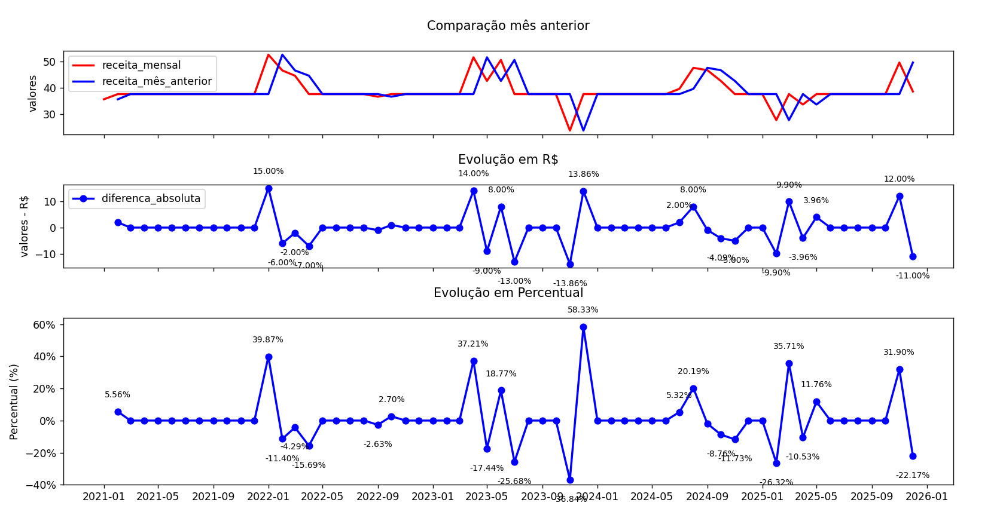

### Módulo 1 — Análise financeira

01. Evolução do faturamento mensal Básico
Solicitação do gestor: precisamos identificar os meses de maior e menor faturamento e avaliar se a receita está crescendo.
Entregáveis:
    receita mensal: Somatória de todo valor arrecadado pela empresa. Tabela `Invoice` tem os dados de datas de pagamentos no campo `InvoiceDate` e tem o valor total de vendas por cada cliente no campo `Total`. Neste caso é só tratar o campo de data para retornar apenas mês e ano, somar o campo de totais e agrupar por mês.

    ``` sql
        SELECT strftime('%Y-%m', invoicedate) as mes_ano, sum(total)as Total_vendas from Invoice
        GROUP by strftime('%Y-%m', invoicedate)
        ORDER by mes_ano 
    ```
    quantidade de pedidos por mês: Na mesma tabela `Invoice` basta fazer um count e agrupar por mês e ano, com o valor resultante do campo de data.
    ``` sql
        SELECT strftime('%Y-%m', invoicedate) as mes_ano, count(*)as qtd_pedidos
        from Invoice
        GROUP by strftime('%Y-%m', invoicedate)
        ORDER by mes_ano 
    ```
	ticket médio mensal: Aqui basicamente usa os resultados acima, na fóruma Tm = Rm / Qp.
    ``` sql
        SELECT strftime('%Y-%m', invoicedate) as mes_ano, (sum(total)/ count(*)) as ticket_medio
        from Invoice
        GROUP by strftime('%Y-%m', invoicedate)
        ORDER by mes_ano 
    ```
    Aqui, uma versão da consulta retornando todas as informações em uma unica consulta
    ```sql
    SELECT strftime('%Y-%m', invoicedate) as mes_ano, sum(total) as Total_pedido, count(*) as qtd_pedido,  (sum(total)/ count(*)) as ticket_medio
    from Invoice
    GROUP by strftime('%Y-%m', invoicedate)
    ORDER by mes_ano    
    ```
    gráfico de linhas:

SQL: strftime(), SUM(), COUNT(), GROUP BY.

-------------------

02. Crescimento mês contra mês (MoM) Intermediário
Solicitação do gestor: quanto o faturamento cresceu ou caiu em relação ao mês anterior?
Entregáveis:
    receita do mês e receita anterior: A consulta da receita mensal já foi feita no ex01, então aqui já vamos aproveitar ela e calcular a receita do mês anterior usando a função `LAG()` junto com um CTE.

    ```sql
        with RECEITA_MENSAL AS
        (SELECT strftime('%Y-%m', invoicedate) as mes_ano, sum(total)as receita_mensal from Invoice
        GROUP by strftime('%Y-%m', invoicedate)
        ORDER by mes_ano)
        SELECT mes_ano, receita_mensal, lag(receita_mensal) over (ORDER by mes_ano) as receita_mês_anterior
        from receita_mensal
    ```
    
    diferença absoluta e variação percentual: Aqui, ambos resultados usam dos mesmos valores para calculo, então foram desenvolvidos juntos.
    Diferença abosluta é a subtração do mês atual menos o mês anterior, e a diferença absoluta é o mesmo calculo, mas mostrado em percentual, ou seja, subtração do mês atual menos o mês anterior, o resultado disto dividido pelo mês anterior e o resultado vezes 100.

    ```sql
        with CALCULO_RECEITA_MENSAL AS
        (SELECT strftime('%Y-%m', invoicedate) as mes_ano, sum(total)as receita_mensal from Invoice
        GROUP by strftime('%Y-%m', invoicedate))
        SELECT mes_ano, receita_mensal, 
        LAG(receita_mensal) over (ORDER by mes_ano) as receita_mês_anterior,
        ROUND(receita_mensal - lag(receita_mensal)over (order by mes_ano),2) as diferenca_absoluta,
        ROUND(
            (((receita_mensal - lag(receita_mensal)over (order by mes_ano)) /
            NULLIF(LAG(receita_mensal) OVER (ORDER BY mes_ano),0)
            )*100),2) as diferenca_relativa
            from CALCULO_RECEITA_MENSAL
            ORDER by mes_ano
    ```
    Gráfico de linhas com os percentuais.


    


SQL: CTE, LAG(), NULLIF() e operações matemáticas.